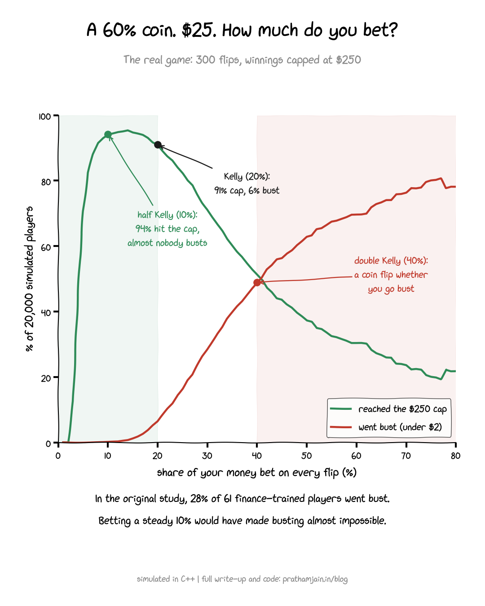

# kelly-sizings

**How much should you bet on a coin that favours you?** In 2016, Haghani and Dewey gave 61 finance-trained
people $25 and a coin that lands heads 60% of the time: 300 flips, winnings capped at $250.
28% went bust. This repo rebuilds that game in C++ and plays it 20,000 times at every bet size from 1% to 80%.



| Bet per flip | Reached $250 | Went bust |
|---|---|---|
| 10% (half Kelly) | **94%** | **0.1%** |
| 20% (Kelly) | 91% | 6% |
| 40% (double Kelly) | 51% | 49% |

With the cap in place, **half Kelly beats full Kelly**: more players reach the maximum and almost none go bust.

Full write-up: [prathamjain.in/blog/kelly-coin](https://prathamjain.in/blog/kelly-coin)

## Run it

```bash
make              # builds the simulator and runs 5 tests
./kelly > results.csv
python3 plot.py   # redraws kelly_real_game.png (needs matplotlib)
```

## Engineering notes

- **Flip by flip, not closed form.** The cap and the bust rule make the game path-dependent, so the binomial
  shortcut is wrong here. Test 5 checks the simulator against the closed form with both rules removed.
- **Log-space wealth.** 300 multiplications accumulate rounding; adding logs doesn't.
- **Reproducible randomness.** xoshiro256** with fixed seeds, because `std::mt19937` plus standard
  distributions can give different numbers on different compilers. Same seed, same chart, everywhere.
- **Fast enough to explore freely:** 20,000 players × 80 bet sizes × up to 300 flips (1.6M games) in about
  0.4 s on one core at `-O2`.

## Layout

| Path | What it is |
|---|---|
| `src/kelly_game.hpp` | RNG, game rules, simulator, growth-rate formula |
| `src/main.cpp` | Sweeps bet sizes 1–80% and prints CSV |
| `tests/test_kelly.cpp` | Kelly optimum, half-Kelly growth, double-Kelly loss, reproducibility, closed-form check |
| `plot.py` | Draws the chart from `results.csv` |

Source: Haghani & Dewey, *Rational Decision-Making Under Uncertainty: Observed Betting Patterns on a Biased
Coin* (2016), [SSRN 2856963](https://papers.ssrn.com/abstract=2856963).
Chart font: [xkcd-script](https://github.com/ipython/xkcd-font) (CC BY-NC 3.0).

by [Pratham Jain](https://prathamjain.in) · [LinkedIn](https://www.linkedin.com/in/pratham-jain-56682620a)
